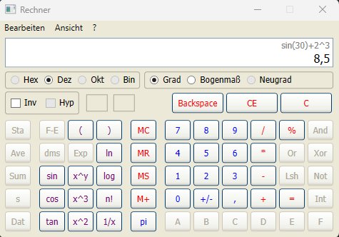

# Wissenschaftlicher Taschenrechner

Ein wissenschaftlicher Taschenrechner in C# mit WPF, angelehnt an den
wissenschaftlichen Rechner von Windows XP.



## Funktionen

**Rechnen**
- Grundrechenarten mit Punkt-vor-Strich-Regel
- Klammern (auch verschachtelt) und negative Vorzeichen (±-Taste)
- Potenzen: x², x³, xʸ, 1/x
- Wurzel (Inv + x²) und Kubikwurzel (Inv + x³)
- sin, cos, tan und die Umkehrfunktionen asin, acos, atan (Inv + sin/cos/tan)
- Grad- oder Bogenmaß umschaltbar
- log (Basis 10), ln und e-Funktion (Inv + ln)
- Fakultät (n!) und Prozent (%)
- Konstanten π und e

**Bedienung**
- Speichertasten MC, MR, MS, M+ (Anzeige „M“, solange etwas gespeichert ist)
- Löschen: C (alles), CE / Backspace (letztes Zeichen)
- Vollständige Tastaturbedienung mit den Kürzeln des Originals
- Zuschaltbarer Verlauf (Ansicht → Verlauf), Doppelklick übernimmt ein Ergebnis
- Dunkles Design (Ansicht → Dunkles Design)
- Verständliche Fehlermeldungen, z. B. bei Division durch 0, fehlenden
  Klammern oder ungültigem Definitionsbereich

## Bedienung

Die Rechnung wird oben in der Anzeige mitgeschrieben, das Ergebnis erscheint
nach „=“ darunter. Funktionen öffnen eine Klammer, z. B. `sin(`, die mit `)`
geschlossen wird. Wie beim Original wird **Inv** angehakt, um die
Umkehrfunktion zu nutzen.

### Tastaturkürzel

| Taste                | Funktion            |
|----------------------|---------------------|
| 0–9, `,` oder `.`    | Ziffern, Komma      |
| `+ - * / ( )`        | Operatoren, Klammern|
| Enter oder `=`       | Berechnen           |
| Backspace            | letztes Zeichen     |
| Entf                 | CE                  |
| Esc                  | C                   |
| F9                   | ±                   |
| `s` / `o` / `t`      | sin / cos / tan     |
| `l` / `n`            | log / ln            |
| `@` / `#`            | x² / x³             |
| `y` oder `^`         | xʸ                  |
| `r`                  | 1/x                 |
| `!`                  | n!                  |
| `%`                  | Prozent             |
| `p`                  | π                   |
| `i`                  | Inv umschalten      |
| Strg+M / R / L / P   | MS / MR / MC / M+   |

## Technik

- C# / WPF, .NET 10
- Oberfläche (`MainWindow`) und Logik (`Calculator`, `Speicher`) sind getrennt
- Der Rechenkern zerlegt den Ausdruck in Tokens, wandelt ihn mit dem
  **Shunting-yard-Algorithmus** in Umgekehrte Polnische Notation (UPN) um
  und wertet diese mit einem Stack aus
- **Polymorphismus:** Jede Funktion ist eine eigene Klasse, abgeleitet von der
  abstrakten Basisklasse `Funktion` (mit den Zwischenstufen `WinkelFunktion`
  und `ArkusFunktion`). Eine neue Funktion braucht nur eine neue Klasse und
  einen Eintrag in der Liste
- Eigene Exception-Klasse `RechenFehler` für verständliche Fehlermeldungen
- Farben als austauschbare Themes (`Hell.xaml`, `Dunkel.xaml`) mit `DynamicResource`
- Unit-Tests mit MSTest für Rechenkern, Funktionen und Speicher

## Projektstruktur

```
ScientificCalculator/
├── docs/                         Lasten- und Pflichtenheft, Screenshot
├── ScientificCalculator/         Anwendung
│   ├── Themes/                   Farbschemata Hell und Dunkel
│   ├── MainWindow.xaml(.cs)      Oberfläche, Tasten- und Tastatureingabe
│   ├── Calculator.cs             Rechenkern (Tokenizer, Shunting-yard, UPN)
│   ├── Funktionen.cs             Funktionsklassen (Polymorphismus)
│   ├── Speicher.cs               Speicherfunktion
│   └── VerlaufEintrag.cs         Eintrag im Verlauf
├── ScientificCalculator.Tests/   Unit-Tests (MSTest)
└── ScientificCalculator.slnx     Projektmappe
```

## Starten und testen

- `ScientificCalculator.slnx` in Visual Studio öffnen und mit **F5** starten
- Tests: **Test → Test-Explorer → Alle Tests ausführen**
